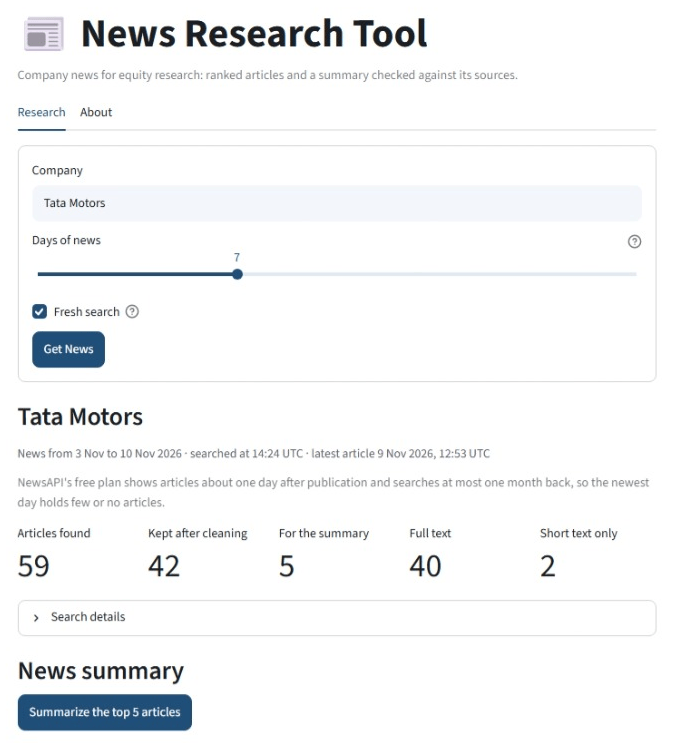
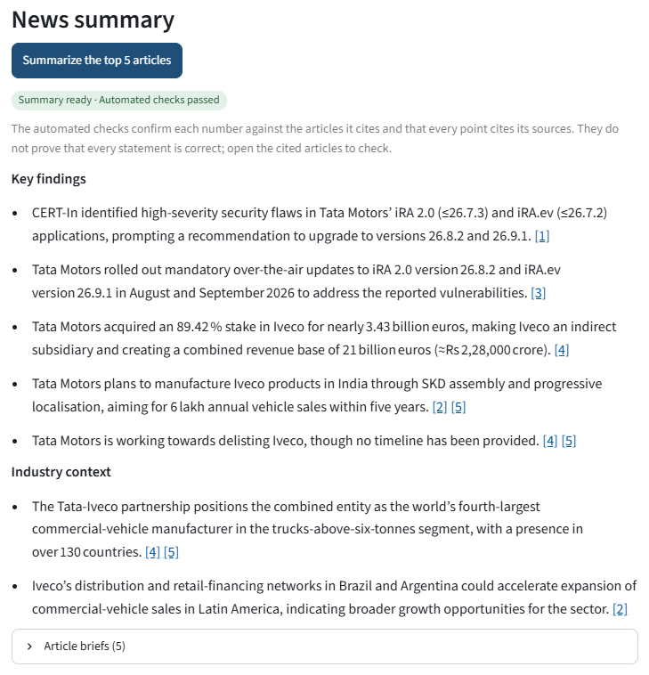

# LLM News Research Tool

Company news for equity research: the tool finds a company's recent news, ranks the articles, and writes a short summary in which every point cites its sources and every number is checked against them.



## Key findings

- **Reading the full article keeps much more relevant news:** 45 of 47 relevant articles instead of 33, and all 24 relevant events instead of 16.
- **A language model is not safe as a filter:** it removes relevant articles, and its `sure` answers are wrong too. The tool never lets it remove an article.
- **The chosen ranking (O1M5 + S1) beats the earlier default on both fresh weeks, but not the plain retrieval order.**
- **Summaries contain no contradicted item in any fresh test,** but on the fresh Tata Motors weeks they cover 3 of 4 events, below the 0.80 target.
- **On a second company, Reliance Industries,** the summary passes in both weeks, and the ranking shows a name-matching weakness: a headline that says only "Jio".

## How it works

1. **Search:** two NewsAPI searches, one for the company name and one for its subsidiaries' names.
2. **Clean:** duplicates, stock-listing pages and unrelated pages are removed, and the full article is read wherever the website allows it (robots.txt respected).
3. **Rank:** articles that name the company in the title, or at least five times in their text, come first (O1M5 + S1). No model call is needed.
4. **Summarize:** a language model (gpt-oss-120b on Groq) summarizes the top 5 articles. Every number in a point must appear in the articles it cites; a point that fails is repaired or removed, with its reason shown.



## Results

| Stage | Question | Result |
|---|---|---|
| 1. Finding and cleaning | Does reading the full article help? | With the full text: 45 of 47 relevant articles kept and all 24 relevant events covered. With short text only: 33 articles and 16 events |
| 2. Relevance check | Can a model safely remove articles? | No: it removes 17 of 18 not-relevant articles but also 3 relevant ones, above the allowed limit. Its answers never remove an article; the app shows them only in an optional review and an experimental order |
| 3. Ranking | Which order and selection? | Model-based orders fail the 180-second limit on the free plan. O1M5 + S1 is chosen on three development days; its fresh-week comparison is below |
| 4. Summaries | Which design, how many articles? | Direct design, k = 5, prompt version 4. Fresh week: no contradicted item; event coverage 0.75, below the 0.80 level |
| 7. Second company | Does it transfer to Reliance Industries? | The summary passes in both Reliance weeks; the ranking loses one direct event in each |

**Ranking on two fresh weeks** (k = 10):

| Fresh week | List | Precision | Events | Direct events |
|---|---|---|---|---|
| Tata Motors, week 2 | retrieval order | 1.00 | 7 / 18 | 5 / 10 |
| | O1M5 + S1 | 1.00 | 6 / 18 | 6 / 10 |
| Reliance Industries, week 2 | retrieval order | 0.80 | 4 / 18 | 4 / 12 |
| | O1M5 + S1 | 0.80 | 4 / 18 | 3 / 12 |

Against the retrieval order, O1M5 + S1 gains a direct event in the Tata Motors week but loses two indirect market events, and in the Reliance Industries week it loses one direct event whose headline names the company only as "Jio". Against the earlier default, O1 + S1, it meets all three conditions in both weeks: no direct event lost, event recall not lower, and precision not lower.

**Consistency of the human judgements:** the same labeller labels 40 development articles a second time without seeing the first labels (`direct`, `indirect` or `not`): agreement 0.825, Cohen's kappa 0.723. A second blind judgement of summary items matches the first on 13 of 15 items in the design comparison and on 16 of 17 items in the third prompt test (94.1%; approximate 95% interval 73% to 99%).

## Stages and evidence

| Stage | Evidence |
|---|---|
| 1. Finding and cleaning | `notebooks/01_stage1_finding_and_cleaning.ipynb` |
| 2. Relevance check | `notebooks/02_stage2_relevance_check.ipynb` |
| 3. Ranking | `notebooks/03_stage3_ranking.ipynb` |
| 4. Summaries | `notebooks/04_stage4_summaries.ipynb` |
| 5. Analyst pipeline | `src/research.py` and its tests |
| 6. Streamlit app | `app.py`, `src/app_flow.py` and their tests; screenshots in `docs/images/` |
| 7. Transfer and fresh-week tests | `notebooks/07_stage7_transfer.ipynb` |

Every test plan is fixed and tagged in Git before its data is fetched or its model runs (`freeze-*` tags). The labelling and judging rules are in `data/eval/LABELLING_GUIDE.md` and `data/eval/SUMMARY_JUDGING_GUIDE*.md`.

## Running it

Python 3.12.

```
pip install -r requirements.txt
```

Copy `.env.example` to `.env` and add a free NewsAPI key and a free Groq key. Then:

```
python check_setup.py
streamlit run app.py
python -m pytest -q
```

On the full project data, all 1,770 tests pass on Python 3.12. This public copy leaves out the raw NewsAPI responses, so the tests that need them skip themselves: `python -m pytest -q` gives 1,738 passed, 32 skipped.

The app runs locally only: NewsAPI's free Developer plan does not allow public deployment.

## Data in this repository

NewsAPI's terms do not allow publishing the data it returns, and article text belongs to its publishers, so publisher text is not included: NewsAPI's raw responses, article descriptions and excerpts, and full article text are left out. Titles, links, labels, events, judgements, scores and every saved result are included. Notebook cells that need article text show the saved result instead.

## Next steps

- Group articles about the same news in the top 10 (S2), so one large story cannot fill several places.
- Count a short name such as "Jio" only when the article cannot refer to another company that shares it, and check every such match against labelled articles for false matches.
- Keep an outlook article's main point when a later article reports the outcome.
- Test each change on development data first, then on a new fresh week.

## Limitations

- Free plans: NewsAPI shows articles about one day late, searches at most one month back and allows 100 requests a day; Groq allows 8,000 tokens a minute and 200,000 a day.
- Small tests: three development days and four fresh weeks (two per company), one summary each, judged by one person.

## License

MIT, © 2026 Manisha Nagda.
